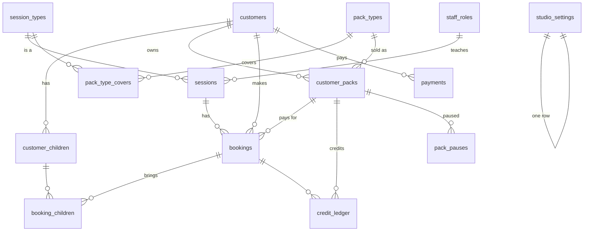

# Database

The plan for the booking database (stage 4). Source of truth: `supabase/migrations/`. Tests: `supabase/tests/`.

## Tables at a glance

| Table | Holds |
|---|---|
| `studio_settings` | One row: name, address, hours, contact details, message links, cancellation cutoff (20:00), booking window (1 month), latest booking (1 hour), reminder time (18:00) |
| `staff_roles` | Each staff login: manager or instructor, display name, instructor access (own sessions only / all customers) |
| `session_types` | Class types, Open Play, Private hire, workshops: colour, picture, length, capacity, drop-in price |
| `pack_types` + `pack_type_covers` | Packs on sale (credits, price, validity, intro flag) and which session types they cover |
| `customers`, `customer_children` | Parents (unique phone in +84 form, unique lowercase email, preferred contact, language) and their children (name, month/year of birth) |
| `customer_packs` | A pack sold to a customer: price copied at sale, valid from/to, pause days |
| `sessions` | Everything on the calendar. One room, so two sessions can never overlap |
| `bookings`, `booking_children` | Who is coming: status, pack used, credits, unpaid amount, free trial, new-customer flag, contacted tick |
| `credit_ledger` | Every credit movement. Never changed or deleted; balance = sum |
| `payments` | QR, transfer or cash, with what it paid for. Managers only |
| `closures`, `pack_pauses` | For the +1 month release (closed days, pausing a pack) |
| `audit_log`, `job_runs` | Staff actions on credits, payments and customers; every scheduled job run |

Coming in later stages: `notifications` (emails sent, stage 8), `calendar_tokens` (stage 8), `login_challenges` (WhatsApp/Zalo login, after business registration).

## How credits work

Each pack's balance is the sum of its ledger rows:

| Event | Ledger row | Balance |
|---|---|---|
| Pack sold (10 classes) | purchase +10 | 10 |
| Class booked | reserve −1 | 9 (shown as "9 remaining, 1 reserved") |
| Cancelled before 20:00 the evening before | return +1 | 10 |
| Class ends (job every 15 min) | use 0 (the reserved credit is now used) | 9 |
| Late cancellation or no-show | forfeit / use 0 | 9 |
| Manager restores it | restore +1 (with a reason) | 10 |
| Bonus credits | bonus +n (with a reason) | +n |

## Rules the database enforces (each has an automated test)

- **Safe booking:** one function (`book_session`, or `book_as_guest` from the server) locks the session, checks capacity, picks the pack, writes the booking and the reserve row together. Two people can't take the last place at once.
- **Which pack:** the one that expires first, among packs that cover the session type and are valid on the session date (pause days included). No suitable pack means pay on the day.
- **Who comes:** class = 1 parent (1 credit or 450,000 ₫) + up to 2 children free. Open play = 1–2 children (1 credit or 150,000 ₫ each) + up to 2 parents free. Capacity counts parents for classes and children for open play.
- **Times:** customers book up to 1 month ahead and up to 1 hour before. Staff can override both, never capacity.
- **Cancelling:** before 20:00 the evening before (Saigon time), the credit comes back. After that only staff can cancel; the credit is used unless a manager restores it.
- **Guests:** matched to an existing customer by phone or email, never a second account. If phone and email point to different customers, the booking goes to the email match and the customer is flagged for a manager. One unpaid booking at a time.
- **Free trial:** given by a manager, classes only, one per customer. Doesn't block the intro pack.
- **Intro pack:** one per customer, only if they've never had a pack or paid for a class.
- **Selling a pack** switches the customer's upcoming unpaid bookings onto it.
- **One room:** sessions can't overlap (cancelled ones don't count).
- **Ledger** can't be edited or deleted. **Money** is whole VND.
- **Anonymise, don't delete:** a customer's name, phone and email are cleared and children deleted; bookings, credits and payments stay.
- **Who can do what:** row-level security on every table. Visitors see the timetable only. Customers see their own details, bookings and credits. Instructors see their own sessions' customers (or all, if a manager allows), never payments. Only managers sell packs, record payments, give trials, restore credits and change the catalog, settings and staff.

## Assumptions to check (owners)

1. **Class names:** until the first month's timetable arrives there is one placeholder type, "Group class". When you send the timetable, each class (Pilates Flow, Mum & Baby Yoga…) becomes its own type, and the 10-, 20-class and intro packs will cover all of them. Tell us if any class should *not* be covered by packs.
2. **"New customer" for the intro pack** = has never had a pack and never paid for a class or pack.
3. **Workshops** (+1 month) are always paid separately, never with pack credits (as in the brief).
4. **A free trial cancelled in time** can be given again; a late-cancelled or no-show trial counts as used.
